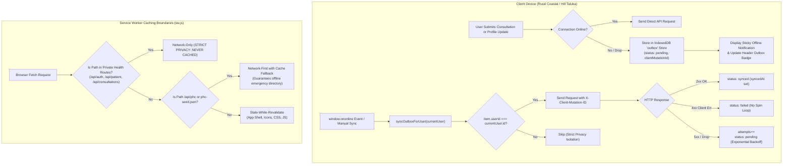
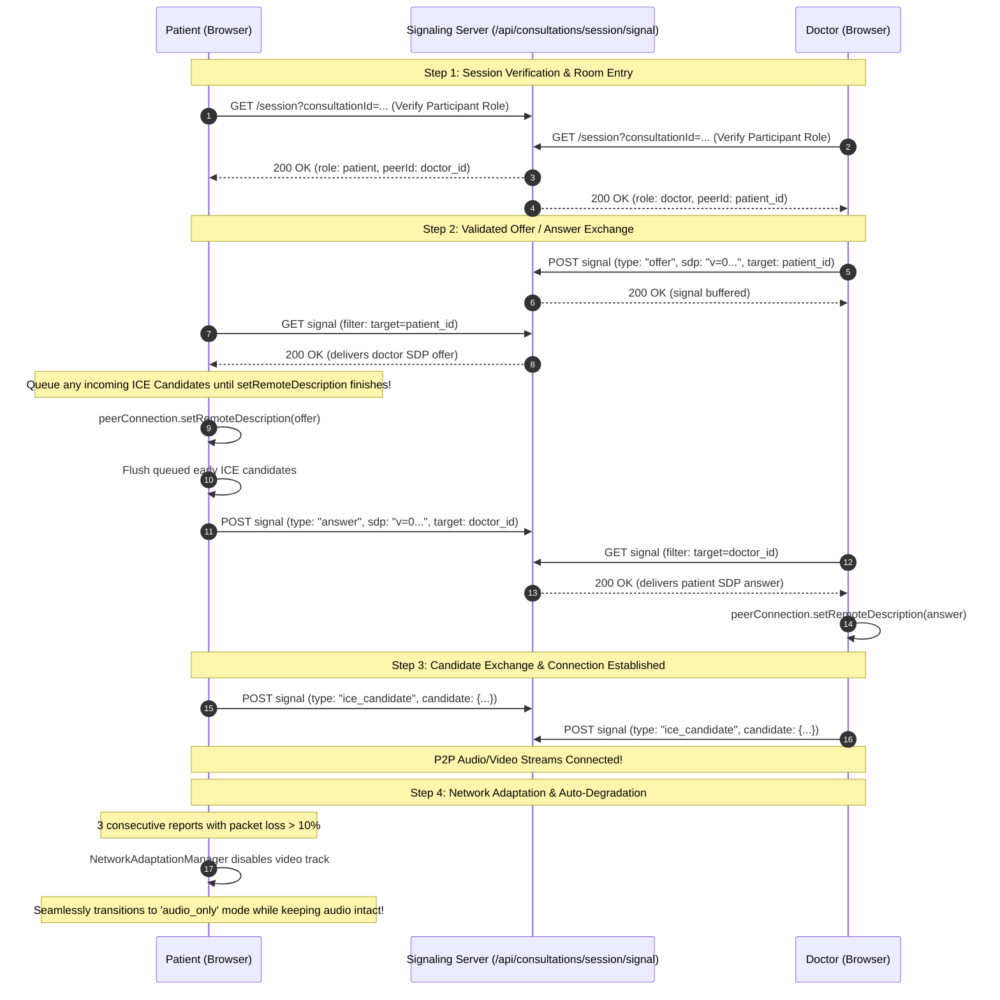

# Samālōcane
**Lightweight Telemedicine Prototype for Low-Bandwidth Coastal & Hill Talukas**
**Phase 1, Phase 2, Phase 3, Phase 4 & Phase 5 Verified Implementation**

---

## 1. Technology Stack (Strictly No Vite)

- **Frontend & Server-Side Framework**: React 18 with **Next.js** (Pages & Serverless API Routes)
- **Styling**: Tailwind CSS with PostCSS, engineered for low-bandwidth rural mobile screens, high contrast (WCAG 2.1 AA), and touch targets >= 44px
- **Database**: PostgreSQL with safe in-memory mock store fallback for offline/isolated evaluation
- **State Machine**: 9-State Server-Enforced Consultation Lifecycle Machine
- **WebRTC Engine**: `RTCPeerConnection` with independent audio/video controls, remote/local streams, and safe candidate queuing
- **Signaling Channel**: Validated bidirectional signaling schema (`offer`, `answer`, `ice_candidate`, `call_ready`, `call_ended`, `call_error`) with IDOR/BOLA protection
- **Dynamic Network Adaptation Manager**: Delta-based packet loss computation ($\frac{\Delta \text{lost}}{\Delta \text{received} + \Delta \text{lost}} \times 100$) and RTT monitoring with hysteresis-protected auto-degradation
- **Offline Outbox Engine**: IndexedDB with structured object store, idempotent mutation IDs (`X-Client-Mutation-ID`), exponential backoff retry logic, and strict user isolation
- **Progressive Web App (PWA)**: Versioned Service Worker with Stale-While-Revalidate for app shell, Network-First for PHC directory, and strict Network-Only bypass for authenticated health records
- **Zero-Login Emergency Mode**: Offline-resilient directory covering verified Karnataka coastal and hill talukas (Kumta, Karwar, Madikeri, Sakleshpur, Bhatkal) with direct cellular `tel:` calling
- **Real-Time Messaging**: Real-Time Chat with Client-side UUIDs, Server-Side Persistence, and Instant Server ACK (`chat:ack`)
- **Security & RBAC**: Cryptographic HMAC-SHA256 JWT sessions in HTTP-only cookies with server-side authorization guards (Preventing self-assigned admin privileges and IDOR/BOLA attacks)
- **Language**: JavaScript (ES6+ / Node.js 22)

---

## 2. Directory Structure

```text
Samalocane/
├── db/                                # PostgreSQL Database Architecture
│   ├── schema.sql                     # DDL (Tables, Enums, Sessions, Signals, Messages, Indices)
│   └── seed.sql                       # Seeds (Verified KMC Doctors, Coastal/Hill PHCs)
├── public/                            # Static Assets, PWA Icons & Service Worker
│   ├── data/
│   │   └── phc-seed.json              # Emergency facility directory for offline use
│   ├── icons/
│   │   ├── icon-192.png               # 192x192 PWA App Icon
│   │   └── icon-512.png               # 512x512 PWA App Icon
│   ├── manifest.json                  # PWA Web App Manifest
│   └── sw.js                          # Service Worker with Privacy Filters & Cache Strategies
├── scripts/                           # Automated Verification Test Suites
│   ├── test-auth-rbac.js              # Token & RBAC guard verification
│   ├── test-db.js                     # Database connectivity & query schema test
│   ├── test-phase2.js                 # 57/57 Phase 2 Automated Test Suite
│   ├── test-phase3.js                 # 43/43 Phase 3 Automated Test Suite
│   ├── test-phase4.js                 # 31/31 Phase 4 WebRTC & Adaptation Test Suite
│   └── test-phase5.js                 # 27/27 Phase 5 PWA, Outbox & Emergency Test Suite
├── src/
│   ├── components/
│   │   ├── common/
│   │   │   └── OfflineOutboxDrawer.jsx# Slide-over local Outbox & synchronization inspector
│   │   ├── layout/
│   │   │   ├── Header.jsx             # Navigation header with Outbox counter & role switcher
│   │   │   ├── Footer.jsx             # Healthcare disclaimers & copyright
│   │   │   └── PortalLayout.jsx       # Shared dashboard shell
│   │   └── ui/
│   │       ├── Alert.jsx              # Reusable medical alerts
│   │       ├── Badge.jsx              # Status badges (Verified, Mode, State)
│   │       ├── Button.jsx             # Touch-friendly accessible buttons
│   │       └── Card.jsx               # Modular card containers
│   ├── hooks/
│   │   └── useWebRTC.js               # React WebRTC & Adaptation Manager hook
│   ├── lib/
│   │   ├── auth.js                    # JWT session creation, verification & cookies
│   │   ├── db.js                      # DB pool & unified in-memory mock store
│   │   ├── rbac.js                    # Server-side withRoleAuth middleware guards
│   │   ├── recommendationEngine.js    # Rule-based symptom router & emergency triggers
│   │   ├── consultationStateMachine.js# Formal 9-State consultation lifecycle engine
│   │   ├── consultationSession.js     # Communication session lifecycle & IDOR guards
│   │   ├── webrtcSignaling.js         # Validated WebRTC signaling exchange & candidate queue
│   │   ├── webrtcClient.js            # Client-side RTCPeerConnection controller
│   │   ├── networkAdaptationManager.js# Delta packet loss & hysteresis degradation engine
│   │   └── indexedDbOutbox.js         # IndexedDB outbox queue, user isolation & sync runner
│   ├── pages/
│   │   ├── _app.jsx                   # PWA SW registration, global offline alert & sync listener
│   │   ├── _document.jsx              # HTML shell & font definitions
│   │   ├── index.jsx                  # Public Landing Page
│   │   ├── emergency.jsx              # Zero-Login Emergency PHC Directory with Cellular Dial
│   │   ├── doctors/
│   │   │   ├── index.jsx              # Filterable Verified Doctor Directory
│   │   │   └── [id].jsx               # Physician Credential Profile
│   │   ├── consultation/
│   │   │   ├── request/
│   │   │   │   └── [id].jsx           # Request Consultation Form with Offline Outbox Fallback
│   │   │   ├── waiting/
│   │   │   │   └── [id].jsx           # 9-State Virtual Waiting Room UI
│   │   │   └── room/
│   │   │   │   └── [id].jsx           # Live WebRTC Consultation Room & Verified Chat
│   │   ├── patient/
│   │   │   ├── index.jsx              # Patient Dashboard & Recommendation Widget
│   │   │   └── profile.jsx            # Health Record Form with Offline Outbox Fallback
│   │   ├── doctor/
│   │   │   └── index.jsx              # Physician Workspace & Consultation Queue
│   │   ├── admin/
│   │   │   └── index.jsx              # Doctor Credential Verification Desk
│   │   ├── auth/
│   │   │   └── login.jsx              # Authentication page with demo switchers
│   │   └── api/
│   │       ├── auth/                  # Login, Logout, Session endpoints
│   │       ├── patient/profile.js     # Patient health profile CRUD
│   │       ├── doctors/               # Filtered verified doctor directory
│   │       ├── recommend/index.js     # Symptom recommendation endpoint
│   │       └── consultations/         # Consultation lifecycle, transitions, sessions, signals & messages
│   └── styles/
│       └── globals.css                # Tailwind directives & accessibility styles
├── package.json
└── README.md
```

---

## 3. PWA & Offline Resiliency Architecture (Phase 5)



### Critical Privacy Guarantee:
To comply with medical privacy standards and prevent cross-patient data leakage on shared rural smartphones:
- **`sw.js` explicitly excludes all authenticated routes** (`/api/auth/*`, `/api/patient/*`, `/api/consultations/*`, `/api/admin/*`, `/consultation/room/*`) from `CacheStorage`.
- Outbox entries in IndexedDB are strictly indexed by `userId`. User A's session will never transmit or expose User B's queued health updates.

---

## 4. WebRTC Signaling Architecture & Adaptation Manager (Phase 4)



---

## 5. Automated Verification Test Suites

Run all test suites natively on Linux:

```bash
# Test 1: Authentication & RBAC Boundaries
node scripts/test-auth-rbac.js

# Test 2: Database Schema & Pre-seeded Facilities
node scripts/test-db.js

# Test 3: Phase 2 Modules (Profiles, Directory, Recommender, State Machine)
node scripts/test-phase2.js

# Test 4: Phase 3 Infrastructure (Session Lifecycle, IDOR Guards, Server ACK)
node scripts/test-phase3.js

# Test 5: Phase 4 WebRTC Engine & Network Adaptation (Signaling, Adaptation, Fallback)
node scripts/test-phase4.js

# Test 6: Phase 5 PWA, IndexedDB Outbox & Emergency Mode
node scripts/test-phase5.js
```

### Combined Test Results (166/166 Tests Passing, 100%):
- **Phase 1 (8 tests)**: Cryptographic tokens, role-based guards, database mockStore synchronization.
- **Phase 2 (57 tests)**: Dynamic DOB age computation, unverified doctor exclusion, symptom recommendation rules, urgent red-flag pathways (chest pain, stroke FAST, anaphylaxis), 9-state consultation machine.
- **Phase 3 (43 tests)**: 8-state consultation sessions, IDOR/BOLA security isolation, idempotent session creation, presence tracking, heartbeat-driven disconnection detection, reconnection recovery, instant message server ACK (`chat:ack`), message deduplication, and connection tier fallbacks.
- **Phase 4 (31 tests)**: WebRTC signaling protocol schema, bidirectional Offer/Answer exchange, candidate queuing before remote description, delta packet loss calculation formula, sustained degradation triggering `audio_only` mode, independent audio preservation, hysteresis recovery window, user camera preference respect, and clean resource teardown.
- **Phase 5 (27 tests)**: PWA manifest validation, maskable icon binaries, Service Worker cache strategies, **critical privacy boundary enforcement (100% Network-Only for health data/APIs)**, IndexedDB outbox queueing, user isolation protection (User A cannot access or delete User B records), idempotent mutations with `clientMutationId`, retry backoff calculation, 4xx permanent failure isolation, and genuine Karnataka PHC directory with cellular `tel:` links.

---

## 6. How to Run the Application on Fedora Linux

1. **Start Development Server**:
   ```bash
   npm run dev
   ```
2. **Open in Browser**:
   [http://localhost:3000](http://localhost:3000)

### Key Portals for Evaluation:
- **Patient Dashboard & Smart Recommender**: [`/patient`](http://localhost:3000/patient)
- **Verified Doctor Directory**: [`/doctors`](http://localhost:3000/doctors)
- **Physician Workspace & Consultation Queue**: [`/doctor`](http://localhost:3000/doctor)
- **Virtual Waiting Room**: [`/consultation/waiting/consult-01`](http://localhost:3000/consultation/waiting/consult-01)
- **Live WebRTC Consultation Room**: [`/consultation/room/consult-01`](http://localhost:3000/consultation/room/consult-01)
- **Zero-Login Emergency PHC Directory**: [`/emergency`](http://localhost:3000/emergency)
